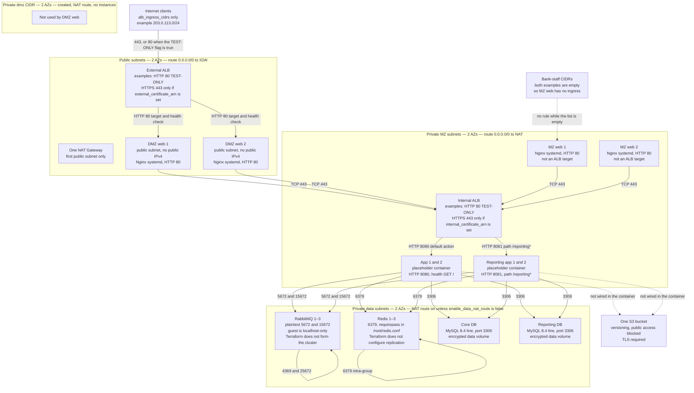

# SCF 4.0 + LOS 4.0 on AWS — architecture design

Status: **the diagram in the next section is what `SCF_LS/` Terraform creates.** The sections after it are the earlier design record. Where they disagree with the diagram, the diagram is the implementation.

## What this Terraform builds

Counts below are `diagram.tfvars.example` (DMZ web 2, MZ web 2, app 2, reporting app 2, RabbitMQ 3, Redis 3, one core DB, one reporting DB). `minimal.tfvars.example` is the same subnet layout with one instance of each tier. Counts are variables, not module defaults. Both examples use the TEST-ONLY HTTP listeners because the certificate ARNs are null.



How to read the arrows. A solid arrow is a security-group path that exists. The containers on the app and reporting instances are placeholders and are not given MySQL, Redis, or RabbitMQ credentials, and stock Nginx does not proxy to the internal ALB. The dotted S3 arrows mean the bucket exists and the application is not connected to it.

DMZ web has no public IPv4 address. It sits on the public route table, whose default route is the internet gateway, so it has no direct internet path for image pull or SSM. The other instance tiers use the NAT Gateway for TCP 443 and DNS only, plus the east-west rules drawn above.

Not created: WAF, Route 53 records, a second region or DR, VPN, AWS Network Firewall, NACLs, EFS, RDS, ECR, ALB access logs, flow logs, backups, and Veefin application deployment.

---


This document translates the Veefin SCF/LOS VM design into AWS. It does not add components the TDD does not mention, except where an AWS primitive is required to host a stated component (a VPC for the VMs, an EBS data volume for a database disk, KMS or AWS-managed encryption). Each of those is marked as a platform mapping, not a new product.

Each contested point is labeled with one of these, and they are not mixed:

| Label | Meaning |
| --- | --- |
| TDD requirement | Text in the Technical Design Document, including its sizing tables. |
| Diagram requirement | What the architecture drawing shows. |
| AWS translation | How that item would be built on AWS, without choosing a contested option. |
| Recommendation | A preference. It is not a decision. |
| Unresolved | Still open. Terraform must not encode it as a default that hides the choice. |

The Veefin architecture diagram is now part of this review. It is a logical picture of the primary site, not a per-environment sizing sheet. Where it disagrees with a sizing table, both are recorded and the count is not chosen silently.

Diagram path, read from the drawing:

```text
Internet (scf / los / reports / apigw .mydomain.com, port 443)
  -> WAF
  -> external load balancer, port 443, drawn as F5, in the DMZ
  -> Web Server 1 and Web Server 2
       (SCF-Frontend, SCF-Admin Portal, LOS-Frontend, Vector-Frontend)
  -> internal load balancer, port 443, drawn as F5, in the MZ
  -> App Server 1 and 2, and Reporting App Server 1 and 2
  -> RabbitMQ Server 1, 2, 3 (ports 5671 / 15671)
  -> Redis Cache 1, 2, 3 (port 6379)
  -> firewall, then MySQL Core DB and MySQL Reporting DB (port 3306) in the DC zone
  -> S3 / NFS, a DR arrow, and a site-to-site VPN toward on-premises CBS
```

The drawing does not show a second copy of the web, app, RabbitMQ, or Redis tiers for DR. DR is an arrow off the data zone. It also does not show MongoDB, Kafka, monitoring, Postgres, or Oracle. A person icon is drawn in the MZ. It is not read as a bastion or an SSH path.

Nothing in `modules/`, `examples/`, or `security_scanner/` was changed.

## How the existing Terraform constrains this design

| Existing object | What it enforces | Why this stack should not call it as-is |
| --- | --- | --- |
| `modules/ec2` | IMDSv2, encrypted gp3/gp2 root, no public IPv4, no SSH key created, T3 credit mode `standard` | AMI choices are only Amazon Linux 2023 or Ubuntu 24.04. Root volume is capped at 100 GiB, so the TDD 120 GiB DB disk does not fit. No extra data volume, no instance profile, no user data. `environment` allows only `dev`, `staging`, `prod`. Default type `t3.micro` and the 8 GiB root are personal-test settings. |
| `modules/s3` | Public access block, AES256, versioning default on, `force_destroy = false` | No lifecycle, no replication, no access logging, no KMS choice. Same `environment` enum. `Environment` overwrites `additional_tags`, so a real name such as `sit` cannot be stored there. |
| `modules/rds` | Encrypted storage, `publicly_accessible = false`, password in Secrets Manager | `multi_az = false` is hardcoded. `skip_final_snapshot` defaults to true and `deletion_protection` defaults to false. Those are test-only. Default class `db.t3.micro` and 1-day backup retention are not the TDD policy. |
| `examples/dev` | Provider in the example root, AWS provider `~> 5.0`, Terraform `>= 1.5.0`, no `allowed_account_ids` | Personal composition. Region default `ap-south-1` is a POC default, not a company standard. |
| Root `.gitignore` | Ignores `*.tfvars`, `*.tfstate`, `*.tfstate.*`, `.terraform/` | Does not yet ignore `tfplan`, `plan.txt`, or `backend.hcl`. That ignore list belongs in `SCF_LS` when Terraform is implemented. Real tfvars stay uncommitted. |

Recommendation: new modules under `SCF_LS/modules/`, copying the security invariants (IMDSv2, encrypted disks, no public instance IP, S3 public-access block, `force_destroy = false`). Do not change `modules/ec2`, `modules/s3`, or `modules/rds` in the first implementation. Existing example plans then cannot change, because those files are untouched.

An additive change to the shared modules is possible later only if it is optional and backward-compatible. It is not required to build this stack, and it is not approved by this document.

---

## 1. Scope and environments

### Options

| Option | What it builds | Cost / risk | Recommendation |
| --- | --- | --- | --- |
| A. All four environments now | SIT, UAT, Prod-DC, Prod-DR | Highest cost. Prod and DR before the network, AMI, and data choices are proven. | No |
| B. SIT only | One small state | Lowest cost. UAT sizing is not identical (UAT splits LOS and SCF and adds RabbitMQ). | Too small |
| C. SIT, then UAT, then Prod-DC, then Prod-DR | Four roots, four states, shared modules | SIT proves the pattern. UAT adds the broker the SIT table omits. Prod and DR wait for Gate 1 answers that are still open (region, CIDR, AMI, database engine). | **Yes** |

### Recommendation

Build in this order:

1. **SIT** — smallest fixed VM set. It is not highly available: several tiers have quantity 1, while an ALB still needs two subnets.
2. **UAT** — same pattern, with LOS and SCF split and RabbitMQ present.
3. **Prod-DC** — the only environment that accepts writes.
4. **Prod-DR** — separate region, separate state, built after DC is understood. DR is active-passive.

Each environment is its own Terraform root and its own state. There is no single state that contains every environment.

Proposed layout, to be created only after this design is approved:

```text
SCF_LS/
  modules/          network, security-groups, alb, compute-tier, efs, backup, vpn
  environments/
    sit/
    uat/
    prod-dc/
    prod-dr/
  docs/
```

SIT does not include a RabbitMQ row. The TDD flow and UAT/Prod tables do. Unresolved: question 18.

---

## 2. Network design

### Options

| Option | Meaning | Cost / risk | Recommendation |
| --- | --- | --- | --- |
| New VPC in this stack | We create the VPC, subnets, and routes | We own the CIDR and can avoid overlap. Duplicates a landing zone if one already exists. | Use only if the company has no VPC for this application |
| Existing company VPC | Subnet IDs are required inputs | No second VPC, no second NAT bill, depends on another team. | **Preferred if a landing zone already exists** |
| This stack creates a VPC only when `vpc_id` is null | One code path, two operating modes | More conditionals. Easy to apply the wrong mode. | Acceptable only after question 1 is answered |

This is an open question, not a decision. The TDD does not say whether Veefin already has a VPC.

### Zone mapping

The TDD zones map to subnets as follows. Two Availability Zones are required because an ALB cannot be created in one subnet.

| TDD zone | AWS | What runs here |
| --- | --- | --- |
| Internet | Outside the VPC | Clients, and the bank's VPN device |
| DMZ | Public subnets, one per AZ, route to an Internet Gateway | External ALB. Web/Nginx instances, with **no public IPv4 address** |
| MZ | Private app subnets, one per AZ, default route to NAT | LOS, SCF, reporting app servers, RabbitMQ, Redis, monitoring |
| DC zone | Private data subnets, one per AZ, no direct internet route | MySQL, MongoDB, EFS mount targets |

"Web tier in public subnets" means the subnet's route table has a path to the internet gateway. It does not mean the instance receives a public IP. The external ALB is the only internet-facing endpoint. Instances stay private so a security-group mistake cannot publish SSH or a database. The shared EC2 module already forces `associate_public_ip_address = false`; a local module must do the same.

A single web node in SIT or UAT still sits in one AZ. The ALB is attached to both public subnets. One AZ has no target. That matches the TDD quantities. It is not a highly available web tier.

### NAT

| Option | Monthly cost shape | Failure behavior | Recommendation |
| --- | --- | --- | --- |
| One NAT Gateway, shared | About one NAT hourly charge, plus data processing | The other AZ loses outbound internet (image pulls, patches) | **SIT and UAT** |
| One NAT Gateway per AZ | About double the hourly charge | Outbound survives an AZ loss | **Prod-DC and Prod-DR** |
| No NAT, only VPC endpoints | Endpoint hourly charges instead | No general internet egress. Patching and any non-AWS URL break | Not sufficient for Docker image pulls unless every image is in ECR |

NAT Gateway is billed per hour and per gigabyte. The figure must be confirmed in the AWS Pricing Calculator for the chosen region. There is no free NAT.

### Endpoints and logs

- **S3 gateway endpoint:** no hourly charge. Use it so backups and ECR layer downloads do not need to hairpin through NAT when the destination is S3.
- **SSM interface endpoints** (`ssm`, `ssmmessages`, `ec2messages`): private admin access without depending on NAT. Interface endpoints are billed per hour per AZ. Recommended in every environment that forbids SSH.
- **ECR interface endpoints** (`ecr.api`, `ecr.dkr`): recommended if image pulls must work while NAT is down. Optional if NAT is accepted as the pull path.
- **VPC Flow Logs:** for this VPC only, to the stack's log bucket. Do not create a company-wide log archive, CloudTrail, or an organization.
- **NACLs:** leave the default allow-all NACL. Security groups are the control. Custom NACLs are stateless and are a common cause of broken return traffic. Add one only if the company standard requires it.

The VPC CIDR is a **required variable with no default**. It must not overlap the bank's on-premises ranges or any peered company VPC. Those ranges are not in the TDD.

---

## 3. DR design

Prod-DR is a second Terraform root in a second region. The region variable has **no default**.

The TDD asks for roughly 250 miles between DC and DR. That distance is a constraint on the region pair, not something Terraform can measure. Whether both regions may be inside India, or data must stay in one country, is a residency question. Unresolved: questions 2 and 3.

### Connectivity between DC and DR

| Option | What we would create | Cost / risk | Recommendation |
| --- | --- | --- | --- |
| Cross-region VPC peering | A peering connection and routes | Low hourly cost. Not transitive. Traffic stays on the AWS network. Not IPsec. | **Yes, if both VPCs are ours** |
| Transit Gateway | Attachment, or a new TGW | TGW is often owned by the landing-zone team. Creating one is out of scope. | Use only an existing TGW ID, if they give us one |
| IPsec VPN between regions | A second VPN | Extra hourly and data charges. Worse latency and throughput than peering. | No, for our own DC-to-DR path |

The bank VPN is a separate path. It is not the DC-to-DR path.

### What is warm

The TDD says app and web are active-active inside a site, and DR is active-passive: only DC accepts writes. NFS (EFS) syncs customer uploads. MySQL uses binary-log replication and point-in-time recovery.

| Tier | DC | DR |
| --- | --- | --- |
| External DNS / WAF / external ALB | Serves users | Provisioned, not in the live DNS record, until a human failover |
| Web and app | Running, in service | The TDD lists the VMs. Whether they are started (warm) or stopped is unresolved (question 28). A stopped fleet costs less and may still meet a 4 hour RTO. |
| RabbitMQ, Redis | Running | Standby nodes. Not a stretched cluster. A stretched queue or cache across 250 miles is not in the TDD. |
| MySQL | Writer on DC only | Replica or restore copy. The mechanism is not chosen, because EC2 binlog replication and an RDS cross-region replica are different designs. Promotion is an operations procedure, not a Terraform apply. |
| MongoDB | Writer set | Async replica or a restored copy. The TDD does not describe Mongo replication. |
| EFS | Source | Cross-region replication |
| S3 | Source buckets | Cross-region replication for the buckets that hold uploads and backups |

### RPO, stated honestly

Binary-log replication is asynchronous. A cross-region RDS read replica is also asynchronous. Neither provides RPO of zero. "Close to 0" means the target is seconds of lag under normal load, not a guarantee. Lag grows when the replica or the network stalls, and transactions committed on DC after the last received event are lost on failover.

Synchronous commit across 250 miles is not what the TDD describes, and it would add a round trip to every transaction. This design does not claim RPO 0.

Point-in-time recovery covers backup restore. It does not, by itself, keep the DR copy within seconds of the writer. Ops still has to take logical or physical backups on the schedule in section 15.

RTO of 4 hours for Transaction Management and Reporting is plausible for a warm standby if DNS cutover, MySQL promotion, and EFS replication status are rehearsed. Terraform will not perform that failover.

---

## 4. Load balancing and TLS

- **TDD requirement:** the hardware table names an Application Load Balancer.
- **Diagram requirement:** both load balancers are drawn as F5.
- **AWS translation:** two ALBs, as the task instruction requires. F5 appliances are not created.
- **Recommendation:** ALB. This is a flagged difference, not a silent substitution.
- **Unresolved:** none, unless the platform team rejects ALB and requires F5. That would be a new decision.

Two ALBs:

| ALB | Scheme | Subnets | Listener |
| --- | --- | --- | --- |
| External | internet-facing | Public, two AZs | 443 only, once a certificate exists |
| Internal | internal | Private app, two AZs | 443 only, once a certificate exists |

Host-based rules on the external ALB, names supplied as variables, default zone suffix left as a placeholder such as `.example.com`:

- `scf.<zone>` → web target group (Nginx fronts SCF-Frontend and SCF-Admin Portal)
- `los.<zone>` → web target group (LOS-Frontend)
- `reports.<zone>` → web target group (Reporting-Frontend)
- `apigw.<zone>` → web target group (API front)

The diagram shows one web tier, two servers, in front of all four names. It does not show four web farms. One external target group is the faithful mapping. Path rules inside Nginx are application configuration, not Terraform.

The internal ALB receives traffic only from the web security group. The diagram draws App Server 1 and 2 separately from Reporting App Server 1 and 2. Reporting servers are **blocked** until question 7 supplies a size. They are not given a target group, an instance type, or a copy of the app-server size. The app-server path-to-port map is question 20. Terraform does not invent a route for every microservice port.

### TLS

| Environment | Listener | Why |
| --- | --- | --- |
| SIT, UAT, Prod-DC, Prod-DR | HTTPS 443 with an ACM certificate ARN | This stack has no "dev" environment. HTTP-only is test-only and is not used here. |

The certificate ARN is **required** and has no default. Terraform does not create a public certificate unless the DNS zone is in this account. Unresolved: questions 14 and 15.

If the company zone is not in this account, Route 53 records are out of scope. The platform team creates the alias to the external ALB.

### WAF

- **TDD requirement:** the sizing tables do not list or price a WAF.
- **Diagram requirement:** a WAF sits on the internet path in front of the external load balancer.
- **AWS translation:** a WAF Web ACL attached only to the external ALB. The shield in the diagram is not a second firewall appliance.
- **Recommendation:** AWS managed rule groups (common rules, known bad inputs, IP reputation), starting in count mode.
- **Unresolved:** which environments enable it (question 22). It is not turned on by a hidden default. WAF is billed per ACL, per rule, and per request.

### Access logs

ALB access logs go to the stack log bucket. That bucket uses the same public-access block and encryption as the other buckets.

---

## 5. Security groups

Every instance rule uses a security-group source. The only exception is the external ALB, whose ingress CIDRs are a **required variable with no default**. A placeholder such as `203.0.113.0/24` belongs in `terraform.tfvars.example`. Production internet exposure is an explicit tfvars value of `0.0.0.0/0` and `::/0` on that one rule, written by a human. It is not a default in code.

There is no SSH rule and no RDP rule. Administration is SSM Session Manager. The instances need an instance profile and network reachability to SSM (NAT or interface endpoints).

| Security group | Ingress | Source | Why |
| --- | --- | --- | --- |
| external-alb | 443 | `external_alb_ingress_cidrs` | Internet or a company proxy, as decided in tfvars |
| web | 443 | external-alb | Nginx |
| internal-alb | 443 | web | Only the web tier may call the app ALB |
| app | 8080, 8081, 8082, 8083, 8084, 8085, 8086, 8087, 8088, 8010, 8091, 9080, 9091, 10080, 11080 | internal-alb | TDD application ports. 9092 is **not** opened here; it is also the Kafka port. See below. |
| app | 3000 | internal-alb | Frontends are normally reached via Nginx on 443. Open 3000 only if question 20 says Nginx proxies to the instance port through the internal ALB. |
| rabbitmq | 5671 | app | AMQPS, the port the TDD names |
| rabbitmq | 15671 | monitoring | Management UI. Not exposed to the internet or the web tier. |
| rabbitmq | 4369, 25672 | rabbitmq | Erlang port mapper and inter-node distribution, required for the 3-node Prod cluster. Not in the TDD port list. Flagged. |
| redis | 6379 | app | Application cache |
| redis | 6379 | redis | Replication between members, whatever the count is. The count is unresolved (question 9). Sentinel port 26379 is not opened. The TDD does not mention Sentinel. |
| mysql | 3306 | app | Application access, through this group, which is the stand-in for the TDD "firewall" |
| mysql | 3306 | mysql | Binary-log replication between the two Prod-DC nodes, and from DC to the DR node over peering |
| mongo | 27017 | app | Only if an application actually uses Mongo. The TDD does not say which one. |
| mongo | 27017 | mongo | Replica-set traffic |
| monitoring | 3000 (Grafana), 9090 (Prometheus), 3100 (Loki) | A required admin CIDR or an internal-only source group | Not on the external ALB. Grafana's 3000 clashes with the frontend port. |
| all instance groups | 9100 | monitoring | Node exporter scrape. The TDD does not name 9100. It is the usual agent port and can be changed. |
| all instance groups | none for 22/3389 | — | SSM only |

### Ports from the TDD that this design does not open, and why

| Port | TDD context | Decision |
| --- | --- | --- |
| 5672, 15672 | Plaintext RabbitMQ equivalents | The TDD specifies 5671 and 15671. Plaintext stays closed. |
| 9200, 9300 | Section 6.2 | These are the usual Elasticsearch ports. No Elasticsearch component is listed. Closed until one is named. |
| 1521 | Section 6.2 | Oracle listener. Oracle is not selected. GoldenGate is stated as not needed for MySQL. Closed. |
| 5432 | Not listed; Postgres appears only as an alternate DB1 engine | Closed unless Postgres is chosen instead of MySQL. |
| 9092 and 2181 | Kafka and ZooKeeper | Kafka is in the stack table and not in any sizing row. Closed until question 21 is answered. LOS-Wrapper also uses 9092. That collision is question 20. |
| 8092, 5000 | Section 6.2, "subject to change" | No component owns them. Closed. |
| 22, 3389 | Not requested | Closed. SSM only. |

Egress: instances may egress to VPC endpoints, NAT, and the peer VPC. The data-tier groups do not need open egress to the internet except through NAT for patching, and that can be limited to the app and web groups if the company accepts a harder patching process for databases. Default recommendation: private subnets use NAT for TCP 443 to the internet so package and image pulls work, and security groups still deny inbound from the internet.

---

## 6. Compute sizing

The TDD describes fixed VMs. This design does not add Auto Scaling.

Prod uses non-burstable types. Burstable types are used only where no current general-purpose size matches the TDD RAM. `t3.micro` from the shared module is not used.

These sizes are the standard x86 ratios (m7i 2 vCPU / 8 GiB per large, c7i 2 vCPU / 4 GiB per large, r7i 2 vCPU / 16 GiB per large, t3.small 2 vCPU / 2 GiB). If the chosen region does not offer m7i, the fallback is m6i / c6i / r6i at the same size. Confirm at plan time. No AWS API was called to check availability.

RAM is never set below the TDD figure. Where the TDD asks for 2 GiB, only a burstable type matches. Where it asks for 4 GiB at 2 vCPU, c7i.large matches. Where it asks for 16 GiB at 2 vCPU, r7i.large matches and provides more RAM than a general-purpose large (8 GiB).

| TDD shape (vCPU / RAM GiB) | Type | Burstable? | Where |
| --- | --- | --- | --- |
| 2 / 2 | t3.small | Yes. No general-purpose type has 2 GiB. | SIT/UAT web, SIT/UAT Redis |
| 2 / 4 | c7i.large | No | Prod web, RabbitMQ, Prod Redis |
| 2 / 8 | m7i.large | No | SIT/UAT DB, UAT LOS app |
| 4 / 16 | m7i.xlarge | No | App servers, monitoring, Prod DB1 |
| 2 / 16 | r7i.large | No | Mongo when the TDD asks for 16 GiB RAM and 2 vCPU |

Counts are tfvars, taken from the TDD tables:

| Tier | SIT | UAT | Prod-DC | Prod-DR |
| --- | --- | --- | --- | --- |
| LOS app | combined with SCF: 1 × m7i.xlarge | 1 × m7i.large | 2 × m7i.xlarge | 2 × m7i.xlarge |
| SCF app | (included above) | 1 × m7i.xlarge | 2 × m7i.xlarge | 2 × m7i.xlarge |
| Web | 1 × t3.small | 1 × t3.small | 2 × c7i.large | 2 × c7i.large |
| DB1 | 1 × m7i.large | 1 × m7i.large | 2 × m7i.xlarge | 1 × m7i.xlarge |
| DB2 Mongo | 1 × m7i.large | 1 × m7i.large | 2 × r7i.large | 1 × r7i.large |
| RabbitMQ | **not in the SIT table** | 1 × c7i.large | 3 × c7i.large | 3 × c7i.large |
| Monitoring | 1 × m7i.xlarge | 1 × m7i.xlarge | 1 × m7i.xlarge | 1 × m7i.xlarge |
| Redis | **not selected** | **not selected** | **not selected** | **not selected** |

The Redis row is intentionally empty. The diagram draws 3 caches. The sizing table says SIT 1, UAT 1, Prod-DC 2, Prod-DR 1. Neither count is selected. Question 9 must pick one count per environment before an instance type is assigned. The type column in section 6 is only the shape that would fit a chosen size, not permission to build the table's count.

Reporting app servers and the reporting database are omitted from this table on purpose. They are blocked. See section 9.

Paired nodes are placed in different AZs. A quantity of 3 (Prod RabbitMQ, if that row is built) is placed 2+1 across the two AZs. A quantity of 1 cannot be spread.

T3 instances, if any remain, use standard CPU credits, matching the shared module, so unlimited mode cannot add surprise charges. Non-T instances do not set credit specification.

Root disks follow the TDD OS-disk column, type gp3, encrypted. The 120 GiB DB disk exceeds the shared module's 100 GiB cap, which is another reason not to call that module. Data files go on a **separate** encrypted gp3 volume. The TDD does not give a second size, so the data volume size is a required variable per database tier. Do not put database files on the root disk.

---

## 7. OS and AMI

| Option | Fit to the TDD | Cost / risk | Recommendation |
| --- | --- | --- | --- |
| RHEL 8.8+ or 9.2+ | Matches the TDD | Red Hat subscription on AWS is a marketplace or BYOL charge. Needs a company subscription. | Use if the company standard is RHEL |
| Rocky or Alma | Matches the stack table | Marketplace or community AMI. Supply-chain review required. Not the shared module. | Use if the company forbids RHEL licensing and still wants a RHEL-compatible OS |
| Amazon Linux 2023 | **Deviates from the TDD** | No extra OS license. Already what `modules/ec2` installs. Docker Engine is straightforward. | Only with written vendor sign-off |
| Ubuntu 24.04 | Not in the TDD | Already in the shared module. Still a deviation. | No |

The AMI ID is a **required variable** (or an SSM parameter name the company already publishes). This stack does not look up "latest" at plan time. A moving AMI ID replaces instances on a later plan.

The company's approved-AMI standard is unknown. Unresolved: question 4.

---

## 8. Bootstrapping

| Option | What Terraform does | Risk | Recommendation |
| --- | --- | --- | --- |
| user_data installs Docker and containers on every boot | Easy to read | First boot is slow, Docker Hub or ECR must be reachable, and user_data is stored in state and in the instance metadata. Secrets must not be placed in it. Drift on every rebuild. | SIT only, and only if the AMI is not ready |
| Pre-baked AMI (EC2 Image Builder or Packer) | Launches an image that already contains Docker, the systemd unit, and the pinned container images | Pipeline is extra work. Image rebuild is how you patch. | **Prod, UAT, and DR** |
| SSM State Manager associations | Terraform creates the instance and the association | Association documents can drift from the AMI. Harder to review. | Optional patching channel, not the installer |

### What Terraform does not do

- Install Java 21, Java 11, Tomcat 9, or PHP 8.2
- Deploy Veefin artifacts from Bitbucket or FTP
- Form a RabbitMQ cluster, a Mongo replica set, a Redis primary/replica pair, or a MySQL replication topology
- Promote DR, cut DNS, or restore a backup
- Register the bank's VPN device on the bank's firewall

Those are operations and application-release tasks. Terraform's job is the nodes, volumes, security groups, load balancers, DNS records if the zone is ours, secret **containers**, and IAM.

### Nginx

A native Nginx package, installed on the AMI and managed by systemd, is the better operational choice: smaller footprint, no dependency on the Docker daemon for the front door, simpler file descriptors and logs.

The explicit request is different: a systemd unit that runs a pinned Nginx container, and every other service as a plain container with `--restart unless-stopped`, with Docker enabled under systemd.

If that request is confirmed, the unit should be the only restart mechanism for Nginx (`Restart=always` on the unit, no second Docker restart policy). The other containers keep `--restart unless-stopped` and are not also wrapped in units, or a double restart will fight itself. The image tag is pinned. The unit file lives in the AMI, not in user_data, for any environment above SIT.

Containers that call AWS APIs with the instance role need IMDS hop limit **2**. Hop limit 1 breaks the credential lookup from inside a container. IMDSv2 stays required either way.

---

## 9. Data stores

### MySQL — decision open

- **TDD requirement:** DB1 is a VM. The sizing cell names MySQL 8.2, Postgres 16, and Oracle 19c for that one VM. The stack table says MySQL 8.0.x. Replication is binary-log replication with point-in-time recovery. Prod-DC quantity is 2. Prod-DR quantity is 1. DR accepts no writes.
- **Diagram requirement:** two MySQL databases, Core and Reporting, behind a firewall icon on port 3306. Postgres and Oracle are not drawn.
- **AWS translation:** either MySQL on EC2, or RDS for MySQL. The firewall icon is security groups, not a firewall appliance. Postgres and Oracle are not in either option unless a later decision adds them. The reporting database is not part of this choice. It is blocked in the next subsection.
- **Recommendation:** none. Both options stay open for the application and platform teams.
- **Unresolved:** question 5. No module, engine, or instance is selected.

| | MySQL in Docker on EC2 | RDS for MySQL |
| --- | --- | --- |
| What matches | The TDD VM and the request to run MySQL in Docker | AWS-managed backups, patching, and a supported engine version |
| Operations | You install the engine, set `binlog`, create the replication user, watch lag, and promote the replica by hand | AWS runs the engine. You still plan failover, parameter groups, and the application cutover |
| Security | You patch the container and the host. The data disk is an EBS volume you encrypt and snapshot | Storage encryption is on. The master password can live in Secrets Manager. The shared `modules/rds` defaults are test-only: Multi-AZ is hardcoded off, skip-final-snapshot defaults on, deletion protection defaults off. A company RDS build cannot use those defaults |
| High availability | One EBS volume is a single disk. Two nodes do not fail over by themselves. Async binlog replication can lose the last transactions | Multi-AZ fails over inside the region. A cross-region replica is still async and can lose the last transactions. RDS backup retention stops at 35 days, so the TDD's 2-month monthly copy needs a separate vault copy |
| RPO | "Close to 0" is not a guarantee | "Close to 0" is not a guarantee |
| What Terraform would do, if this option is chosen later | Instances, encrypted gp3 data volumes separate from root, security groups, private DNS. It would not form replication | A database, a subnet group, encryption, backups, and deletion protection as explicit settings. It would not promote DR |

If EC2 is chosen later, the data volume size is question 6. It is not copied from the 120 GiB OS-disk figure.

### Reporting tier — blocked

- **TDD requirement:** the sizing tables do not give reporting app servers or a reporting database their own quantity, cores, RAM, or disk.
- **Diagram requirement:** Reporting App Server 1 and 2, and a MySQL Reporting DB, separate from the app servers and the core database.
- **AWS translation:** would be another compute tier and another database only after sizes exist. No instance type is inferred from the app tier or from DB1.
- **Recommendation:** do not build this tier in the first Terraform.
- **Unresolved:** questions 7 and 8. This tier is blocked, not deferred inside a default of zero that can be turned on without new numbers.

### MongoDB

- **TDD requirement:** DB2 is a VM. Quantities are SIT 1, UAT 1, Prod-DC 2, Prod-DR 1. Versions disagree (section 10).
- **Diagram requirement:** MongoDB is not drawn.
- **AWS translation:** EC2 instances, encrypted data volumes, security group, private DNS. DocumentDB is not assumed. Terraform does not run `rs.initiate`.
- **Recommendation:** none on topology.
- **Unresolved:** question 10. Two Prod-DC nodes cannot elect a primary. A replica set needs an odd number, usually 3, or an arbiter. A single node has no replica. No third node is added unless that question says so.

### Redis — count not chosen

- **TDD requirement:** Redis 7.0. Counts in the sizing tables: SIT 1, UAT 1, Prod-DC 2, Prod-DR 1. Sentinel is not mentioned.
- **Diagram requirement:** Redis Cache 1, 2, and 3, port 6379.
- **AWS translation:** EC2 instances in private subnets, port 6379 from the app security group and between Redis members. Port 26379 stays closed until a chosen topology needs Sentinel.
- **Recommendation:** none. Do not treat the table's 2, or the diagram's 3, as the count.
- **Unresolved:** question 9, one integer per environment. Question 12 is the separate license decision. Terraform assigns no instance type and no count until question 9 is answered.

### RabbitMQ

Prod quantity 3 can be a cluster. SIT has no row. UAT has one node, which is not a cluster. Terraform does not run `rabbitmqctl` to form the cluster.

Erlang distribution ports are in the security group (section 5) because a 3-node cluster cannot form without them. They are not in the TDD port list.

---

## 10. Versions

The request was "one version below the current latest" for Nginx, RabbitMQ, Redis, and MySQL. That phrase is **not** implemented as "current patch minus one". A previous patch can be the vulnerable one. A previous major line can be past community support. This document pins nothing.

The check, in order, before any tag is written into Terraform:

1. Identify the current vendor-supported stable release.
2. Identify the previous supported release line, not merely the previous patch.
3. Reject any release that is end of life or known-vulnerable.
4. Pin an exact version only after that check, and only after the open decision below is answered.
5. If the requested policy conflicts with support or security, record the conflict. Do not pick a tag to make the conflict go away.

Sources checked on 6 October 2026 from the vendors' public pages. Docker image tags were not verified. No image is tagged `latest`. No image tag below is approved for the build.

| Product | Current vendor-supported stable | Previous supported line | TDD request | Rejected | Unresolved |
| --- | --- | --- | --- | --- | --- |
| Nginx | 1.30.5 stable (15 Sep 2026). It includes the fix for CVE-2026-90439. 1.31.6 is mainline, not the stable line. | 1.28.3, still listed by nginx.org as a legacy branch | Sizing: 1.22. Enterprise option: Nginx Plus 1.25 | 1.22 is legacy. 1.30.4 is the previous patch and does not contain the CVE-2026-90439 fix, so it is not a safe "one below". Nginx Plus is commercial and is not assumed | Which supported non-vulnerable release the platform team accepts. Not pinned |
| RabbitMQ | 4.3.6 (16 Sep 2026). Community support for the 4.3 line ends 30 Nov 2026 | 4.2: community support ended 31 Jul 2026, commercial support is longer. 3.13 community support ended 30 Sep 2024. 3.12 community support ended 29 Feb 2024 | Sizing: 3.10+. Stack table: 3.12+ | 3.10, 3.12, and 3.13 are past community support. 4.3.5 is only the previous patch inside a line that loses community support within weeks. It is not a previous supported line | Question 11. The application team must name a certified, still-supported series. Not pinned |
| Redis | 8.10.2 (17 Sep 2026) on the 8.10 release notes. License for 8 and later: RSALv2, SSPL, or AGPL | 7.2 is the last BSD-3-Clause line. 7.4 is RSALv2 or SSPL. 8.8 is an earlier 8.x line, same tri-license as 8.10 | 7.0 | A pin of 8.10.1 would still be the 8.x license. 7.0 is older than the last BSD line and is not treated here as a confirmed supported target | Question 12. Legal must accept a license, or reject Redis 8. Valkey is BSD and protocol-compatible, and it is not in the TDD. Not pinned |
| MySQL | Two current LTS lines: 8.4.11 (30 Jun 2026, premier support to 30 Apr 2029) and 9.7.2 | 8.0, in sustaining support since 21 Apr 2026, which means no new fixes. 8.2 was a short innovation release | Sizing cell: 8.2. Stack table: 8.0.x | 8.0 and 8.2 for a new deployment. 8.4.10 is only a previous patch and is not selected by this document | Which supported LTS line, 8.4 or 9.7, after question 5 chooses EC2 or RDS. The RDS version string must exist in the chosen region. Not pinned |

MongoDB is not in the "one version below" request. The same check still applies.

- **TDD requirement:** 7.0 for SIT, UAT, and DR; 5.0 for Prod-DC; 8.3 in the stack table.
- **Current public stable:** the 9.0 series on the MongoDB release-notes page. 8.3 is a real previous stable line. 8.0 is supported through 31 October 2029. 7.0 is published through 31 August 2027.
- **Rejected:** 5.0, end of life 31 October 2024.
- **Unresolved:** question 10. Not pinned.

Monitoring (Prometheus 2.46+, Grafana 10.0.3, Loki 2.7.6) is outside the version request. Those TDD pins are from 2023 and have had later security fixes. Question 26 decides whether they stay or move. They are not silently upgraded.

After a version is chosen, the platform team confirms the image before it is written into an AMI or a unit file:

```text
docker buildx imagetools inspect <registry>/<image>:<exact-tag>
```

---

## 11. Container registry

| Option | Risk | Recommendation |
| --- | --- | --- |
| Direct Docker Hub pulls | Anonymous rate limits. A moved tag or a compromised public image is pulled straight into the account. | No, for any environment that will hold company data |
| ECR pull-through cache | First pull still contacts Docker Hub, then the image is stored in the account. Later pulls stay inside AWS. | **Yes**, unless the company already runs a golden registry |
| Existing private mirror | Best supply chain, if it exists | Use it if question 27 names one |

Pin by digest in the AMI build once the tag is confirmed. Terraform and the systemd unit must not say `latest`.

Creating an ECR pull-through cache is a regional resource in this account. It is not an organization policy. If the platform team already owns ECR, we consume their repository URL and do not create a second cache.

---

## 12. Secrets and IAM

No secret value in Terraform code, tfvars, user_data, outputs, or a secret version resource.

| Approach | What lands in state | Recommendation |
| --- | --- | --- |
| Secrets Manager secret resource, no secret version | Name, ARN, KMS key id. Not the password. | **Yes** |
| Secret version with a generated password | The password is in state unless a `sensitive` lifecycle and an external store are used carefully. `manage_master_user_password` on RDS still stores the secret ARN, and the value is recoverable by anyone who can read state. | Only if RDS is chosen and the company accepts that state pattern |
| Values pasted into tfvars | They will be in state and in the tfvars file. | No |

Instance role, least privilege, one role per tier rather than one admin role:

- `secretsmanager:GetSecretValue` on the specific secret ARNs for that tier
- `ssmmessages`, `ssm`, and `ec2messages` actions required by Session Manager, not `ssm:*`
- CloudWatch agent put-metric and put-log on the stack's log group and namespace
- `s3:GetObject` / `s3:PutObject` only on the backup or upload bucket prefixes that tier uses
- ECR pull actions only if that tier runs containers

Optional variables, defaulting to null:

- `permissions_boundary_arn` — attached when the company requires one
- `existing_instance_role_name` — used when this stack is not allowed to create roles

If both are null, the stack creates the roles. If the company forbids `iam:CreateRole`, apply cannot succeed until the existing role names are provided. That is a deploying-role dependency, not something to work around with `*` policies.

---

## 13. Encryption

| Option | Behavior | Recommendation |
| --- | --- | --- |
| AWS-managed keys (`alias/aws/ebs`, `alias/aws/s3`, `aws/elasticfilesystem`, `aws/secretsmanager`) | No key policy to write. No extra key charge. Cannot be shared across accounts as easily. | Acceptable for SIT if the company agrees |
| One customer-managed KMS key per environment, rotation on | Key policy must allow the account root, the backup service, EBS, EFS, S3, and Secrets Manager. Cross-region replica needs a key in the DR region. | **Prod-DC and Prod-DR**, if it matches the company standard |

The company standard is unknown. Unresolved: question 24. The shared S3 module hardcodes AES256 (an AWS-managed S3 key, not a CMK). A local bucket is required if the standard is a CMK.

EBS, EFS, S3, and Secrets Manager are encrypted in every environment. Unencrypted is not a variable.

---

## 14. Storage

### S3

Separate buckets, names supplied as variables (the account and a prefix make them unique; the name is not invented from an account ID hardcoded in the repo):

| Bucket | Contents | Replication |
| --- | --- | --- |
| logs | ALB access logs, VPC flow logs | Same region. Lifecycle is optional and has **no default**, because retention is the compliance team's decision. |
| uploads | Customer files the TDD puts in S3 | Prod-DC replicates to Prod-DR when DR exists |
| db-backups | Logical dumps written by ops | Same replication choice. Not a substitute for volume snapshots. |

Settings that are not optional: block public access, encryption, versioning on, `force_destroy = false`. Lifecycle rules are optional objects with no default, so a missing rule keeps objects until a human adds one. That can grow the bill. It is the TDD's position that the compliance team decides.

The TDD sizes (500 GB SIT/UAT, 2000 GB Prod) are capacity planning numbers, not an S3 quota. S3 does not provision a disk of that size.

### NFS mapped to EFS

EFS replaces the NFS VM. Capacity is elastic. The 200 GB and 1000 GB figures are expected usage, not a provisioned volume, unless provisioned throughput is chosen.

| Throughput mode | Behavior | Recommendation |
| --- | --- | --- |
| Bursting | Cheap at low utilization, credits can run out | SIT/UAT if usage stays low |
| Elastic | Pay for what is used, no credit stall | **Prod**, unless the company mandates provisioned |
| Provisioned | A fixed MiB/s bill | Only if a benchmark says so |

Mount targets in both AZs, encryption at rest, and TLS in transit (`tls` mount option). AWS Backup covers the file system. Prod-DC uses EFS cross-region replication to Prod-DR for the customer-upload sync the TDD describes. Replication is not instantaneous; it is another async lag on top of MySQL's lag.

---

## 15. Backup

AWS Backup plan, values as variables so the compliance team can change them, **defaults set to the TDD numbers** because the TDD states them (unlike object-retention, which it explicitly leaves open):

| Rule | Frequency | Retention |
| --- | --- | --- |
| Daily incremental | Daily | 2 days |
| Weekly full | Weekly | 2 weeks |
| Monthly full | Monthly | 2 months |

Resources: EBS data volumes and EFS. A backup vault in the same region. Cross-region copy into the DR vault is optional and off until Prod-DR exists.

RDS, if chosen, uses its own backup retention (maximum 35 days), which does **not** express "2 months" of monthly full backups. The monthly retention beyond 35 days has to be a copy to the backup vault or a snapshot copy. That gap is noted so it is not missed.

Logical dumps of MySQL and MongoDB to the db-backups bucket are an operations job. Terraform creates the bucket and the IAM permission. It does not install the dump script.

The TDD also says Veefin recommends 5 years production plus 7 years archive, while the client compliance team decides. Those periods are **not** the defaults. Putting 7 years in as a silent default would ignore the TDD and create a large bill.

Maintenance window Saturday 23:00 IST to Monday 05:00 IST is the preferred backup and patch window. The actual cron is a variable, because IST only matters once the region and the company's change calendar are confirmed.

---

## 16. Monitoring

One monitoring instance per environment, sized from the TDD (4 vCPU, 16 GiB, 100 GiB disk): Prometheus, Grafana, and Loki as the TDD names them.

CloudWatch alarms, proportionate set:

| Alarm | Threshold | Source |
| --- | --- | --- |
| CPU | 85% | EC2 metric |
| Memory | 85% | CloudWatch agent. The basic EC2 namespace does not include memory. |
| Disk | 90% | CloudWatch agent, root and data volumes |
| ALB unhealthy targets | any target group unhealthy | ALB metric |
| ALB 5xx | a small count; the TDD does not give a number | Ask before setting a page threshold |

One SNS topic. Subscription emails or HTTPS endpoints are a required list when alarming is on, and an empty list is allowed only in SIT so a topic can exist before the escalation matrix exists. The matrix does not exist yet. Do not invent pager addresses.

Prometheus on the VM and CloudWatch alarms overlap. Both stay: the TDD asked for Prometheus, and CloudWatch is what pages AWS when the VM itself is down. Grafana is not published on the external ALB.

Account-level CloudTrail, GuardDuty, and Config are not created. If they exist, this stack only needs permission to be seen by them.

---

## 17. Site-to-Site VPN

Optional. Default off. When `enable_site_to_site_vpn` is true, these inputs are required and have no default:

- Customer gateway public IP (the bank)
- Routing type: `bgp` or `static`
- On-premises CIDRs
- Attachment: a virtual private gateway on this VPC, or an existing Transit Gateway ID

This stack does not create a Transit Gateway.

Both Prod-DC and Prod-DR tables list one VPN. That may mean each region peers to the bank, or it may mean the TDD copied the row. Recommend one VPN in DC, and a DR VPN only if the bank will configure a second tunnel. A VPN that the bank has not configured still costs the AWS hourly charge.

Cost shape: VPN connection hourly charge plus data processing, in each region where it is enabled. Lead time is the bank's change window, not ours. BGP needs ASN numbers the TDD does not contain.

---

## 18. Remote state

**Blocker for apply.** Not a blocker for later `validate`.

The company backend standard is unknown. Local state is acceptable for `terraform init -backend=false` and for a plan the operator runs. It is not acceptable for a shared company apply.

Proposed, and not created by Terraform in this repository:

- An S3 bucket with versioning, encryption, and public access blocked
- A DynamoDB lock table, or S3 native locking if the company standard has moved to that
- `backend.hcl.example` with placeholders only
- Real `backend.hcl` gitignored

This design does not create those resources. Creating them is a platform-team action, often in a different account. Until that exists, nobody should apply this stack.

---

## 19. Tagging and naming

Provider `default_tags`, on every environment root:

| Tag | Value |
| --- | --- |
| Owner | required variable |
| Team | required variable, `^[a-z0-9-]+$`, for example `scf-ls` |
| Environment | `sit`, `uat`, `prod-dc`, or `prod-dr` |
| ManagedBy | `Terraform` |
| Application | `scf-los` unless the company names it differently |

Name pattern, if the company has none: `scf-ls-<env>-<tier>-<index>`.

The shared modules cannot store `sit` or `prod-dc` in `Environment` today. Local modules can. Extra tags the company may require (CostCenter, DataClassification, and any mandatory tag policy) are question 25. A tag policy that rejects unknown tag sets will fail apply. It should be confirmed before the first plan.

---

## 20. Dependencies outside this stack

| Dependency | Why it matters |
| --- | --- |
| Account and region | `allowed_account_ids` is required so a plan against the wrong account fails |
| VPC or permission to create one | Question 1 |
| CIDR and on-premises routes | Question 1 and question 23 |
| Approved AMI | Question 4 |
| ACM certificate | Required for every listener in this design |
| Public DNS zone | If it is not in this account, records are manual |
| KMS standard, or permission to create a key | Question 24 |
| IAM permission boundary, or pre-created roles | Question 17 |
| ECR or a private registry | Question 27 |
| Central logging / CloudTrail / GuardDuty / Config | Consumed if present, never created here |
| Transit Gateway | Not created. Used only if an ID is given |
| Bank customer gateway | VPN cannot come up without it |
| Backup account or vault for long retention | Only if compliance retention leaves this account |
| Deploying role | See the permission list below |

The deploying role needs, only for the services this design would create: EC2, VPC, ELB, WAF (if enabled), EFS, S3, KMS, IAM (role and policy, unless roles are supplied), Secrets Manager, SNS, CloudWatch, AWS Backup, VPN (if enabled), SSM parameter read for nothing secret, and Route 53 only if the zone is in this account. It does not need permission to change organization policies, CloudTrail, or GuardDuty.

---

## 21. Cost estimate

These are **order-of-magnitude on-demand estimates**, not a quote. They use rough public Linux hourly shapes (about $0.02 for t3.small, $0.09 for c7i.large, $0.10 for m7i.large, $0.13 for r7i.large, $0.20 for m7i.xlarge), 730 hours, about $0.08/GB-month for gp3, about $16/month base per ALB, about $32/month per NAT Gateway before data, about $0.30/GB-month for EFS, about $0.023/GB-month for S3, and about $36/month per VPN before data. Regional prices differ. Data transfer, LCUs, WAF requests, backup storage, Support, tax, and Marketplace AMI fees are extra. Confirm every number in the AWS Pricing Calculator before anyone treats it as a budget.

| Class | SIT | UAT | Prod-DC | Prod-DR |
| --- | --- | --- | --- | --- |
| EC2 | ~$470 | ~$620 | ~$1,700 | ~$1,450 |
| EBS (OS disks only) | ~$35 | ~$40 | ~$90 | ~$80 |
| ALB × 2, base only | ~$33 | ~$33 | ~$33 | ~$33 |
| NAT | 1 × ~$32 | 1 × ~$32 | 2 × ~$65 | 2 × ~$65 |
| EFS at the TDD's stated size | 200 GB ~$60 | 200 GB ~$60 | 1000 GB ~$300 | 1000 GB ~$300 |
| S3 at the TDD's stated size | 500 GB ~$12 | 500 GB ~$12 | 2000 GB ~$46 | 2000 GB ~$46 |
| VPN, if enabled | ~$36 | ~$36 | ~$36 | ~$36 |
| WAF, if enabled | ~$10–30 plus requests | same | same | same |
| Backup | incremental, grows | same | same | cross-region copy adds storage |
| **Rough total before data transfer** | **about $700–900** | **about $850–1,100** | **about $2,400–3,200** | **about $2,100–2,900** |

Database data volumes are **not** in the EBS row, because the TDD gives one disk figure and this design adds a second volume whose size is still an open input. Two NAT Gateways, a VPN in both regions, WAF, and cross-region replication can push Prod-DC plus Prod-DR above $6,000 per month before traffic. A savings plan or reserved instances would lower EC2 only after the types are stable.

SIT plus UAT together are the right first budget conversation. Prod-DC and Prod-DR should not be applied in the same change window as the first SIT plan.

---

## 22. Inconsistencies, assumptions, out of scope, open questions

### Inconsistencies in the TDD

1. MongoDB is 7.0 (SIT, UAT, DR), 5.0 (Prod-DC), and 8.3 (stack table). 5.0 is past its published end of life (31 October 2024). 8.3 and 9.0 both exist as public release lines.
2. RabbitMQ is 3.10+ in sizing and 3.12+ in the stack table. Both community support windows have ended. The current community line is 4.3, and that line's community support ends 30 November 2026.
3. LOS Java is 11 in sizing and JDK 21 in the stack table. Terraform will not install either. The application team still has to pick one.
4. Nginx is 1.22 in sizing and Nginx Plus 1.25 as an enterprise option. Current open-source stable is 1.30.5.
5. Section 5.5 says one instance per node in DR. The DR table lists 2 LOS app, 2 SCF app, and 2 web nodes. Neither number is selected. Question 19.
6. Ports 9200 and 9300 are listed. No Elasticsearch (or OpenSearch) component is listed.
7. The diagram draws 2 web servers, 2 app servers, 2 reporting app servers, 3 RabbitMQ nodes, 3 Redis nodes, a WAF, and two MySQL databases (Core and Reporting). The sizing tables do not list reporting app servers or a reporting database, and they list fewer Redis nodes (Prod-DC 2, other environments 1). SIT has no RabbitMQ row. The DB1 cell also names Postgres 16 and Oracle 19c, which the diagram does not draw. MongoDB is in the sizing tables and is not in the diagram.
8. The diagram shows F5. The hardware table says Application Load Balancer. This design uses ALBs.
9. OS is RHEL or CentOS Stream in one place, and AlmaLinux, Rocky, or RHEL in the stack table. CentOS Stream is not proposed. The shared module is Amazon Linux 2023, which matches none of those.
10. "One version below latest" conflicts with the TDD's pinned majors, and a blind previous patch can be the vulnerable build. No version is pinned. Section 10.
11. Data retention is "the client's compliance team decides" and also "Veefin recommends 5 years plus 7 years archive". The backup schedule (2 days / 2 weeks / 2 months) is a third, shorter number.

### Assumptions used so this document could be written

- Four environments, four states, SIT first.
- ALBs, not F5.
- Web instances in public subnets with no public IP.
- No SSH and no RDP.
- No Auto Scaling.
- No shared-module edits.
- Kafka, Elasticsearch, Oracle, GoldenGate, and Postgres are out of the first build.
- HTTP is not offered on these ALBs.
- Terraform does not form clusters and does not deploy the Veefin build.

### Out of scope

- Account-level CloudTrail, GuardDuty, Config, organization policies, and a landing-zone Transit Gateway
- Installing language runtimes and deploying artifacts
- Cluster bootstrap and DR failover execution
- F5, Nginx Plus, Oracle, GoldenGate
- A monitoring escalation matrix that does not exist yet
- Backend bucket creation
- `terraform apply`

### Open questions

Numbered once, from 1. The same number is not reused. Gate 1 does not answer them.

1. VPC: does this stack create a VPC, or do you supply existing subnet IDs? Input: CIDR with no overlap against on-premises and peered networks, or the subnet IDs, plus who owns the VPC.
2. Prod-DC region. Input: an AWS region code. No default.
3. Prod-DR region and data residency. Input: an AWS region code about 250 miles from DC, and a yes or no on whether that pair is allowed.
4. Approved AMI. Input: AMI ID or company SSM parameter name, per region. One of RHEL, Rocky, Alma, or Amazon Linux 2023 only with written vendor sign-off.
5. MySQL architecture. Input: `ec2` or `rds` for the core database. Both stay open. Reporting is not decided here.
6. Core data-volume size, only if question 5 is `ec2`. Input: GiB for the core MySQL data disk, and GiB for MongoDB. Not the 120 GiB OS-disk figure unless you say it is the data disk.
7. Reporting app servers. Input: quantity, vCPU, RAM GiB, and OS-disk GiB for SIT, UAT, Prod-DC, and Prod-DR. **Blocked** until those twelve numbers exist. The diagram's "2" is not a size.
8. Reporting database. Input: quantity, vCPU, RAM GiB, and data-disk GiB for each environment, and `ec2` or `rds` if it is allowed to differ from question 5. **Blocked** until that exists. It will not copy DB1.
9. Redis node count. Input: one integer for SIT, one for UAT, one for Prod-DC, one for Prod-DR. Diagram shows 3 on the drawn site. Sizing table shows 1, 1, 2, and 1. No count is selected.
10. MongoDB version and topology. Input: a version other than 5.0, and for Prod-DC either "2 nodes, no election", "3 nodes", or "2 plus an arbiter".
11. RabbitMQ version. Input: an exact supported release the application team has certified. 3.10, 3.12, and 3.13 are past community support. 4.3.6 is the current community line and that line's community support ends 30 November 2026. Not pinned.
12. Redis product and license. Input: written acceptance of Redis 8 (RSALv2, SSPL, or AGPL), or a named BSD build (Redis 7.2 or Valkey), or a rejection. The TDD says 7.0. Not pinned.
13. External ALB ingress. Input: the CIDR list, including whether production is `0.0.0.0/0` and `::/0` on TCP 443 only. No default.
14. ACM certificate. Input: certificate ARN per environment. No default.
15. Route 53. Input: whether the public zone is in this account. If no, the name of the team that creates the alias records.
16. Remote state. Input: account, bucket name, region, and lock table or lock method. This repository will not create them. Apply stays blocked without them. `validate` does not need them.
17. Existing platform ownership. Input, each as "this stack creates it" or "use the existing one" plus an ID or name pattern, never a secret: Transit Gateway, site-to-site VPN, KMS key, IAM instance roles, IAM permissions boundary.
18. SIT RabbitMQ. Input: yes or no to one node. The SIT sizing row is empty. The diagram and the other environments include RabbitMQ.
19. DR web and app count. Input: 2, as the DR table, or 1, as section 5.5. Neither is selected.
20. App port map. Input: which microservice ports the internal ALB may open, whether port 3000 is one of them, and which process owns 9092 (LOS-Wrapper or Kafka).
21. Kafka. Input: in this build or out. If in, node count and disk GiB. There is no sizing row today.
22. WAF. Input: on or off per environment. The diagram shows one. The sizing tables do not price one.
23. Bank VPN, when question 17 says this stack creates it. Input: DC only or DC and DR, `bgp` or `static`, customer gateway public IP, on-premises CIDRs. Those values stay out of git and out of the example file except as placeholders.
24. KMS, when question 17 says this stack creates keys. Input: one customer-managed key per environment, or AWS-managed keys.
25. Extra tags. Input: required tag keys beyond Owner, Team, Environment, ManagedBy, and Application, and any name prefix.
26. Monitoring versions. Input: keep Prometheus 2.46+, Grafana 10.0.3, and Loki 2.7.6, or name supported replacements.
27. Container registry. Input: an existing ECR or mirror URL, or permission for this stack to create an ECR pull-through cache.
28. DR power state. Input: running (warm) or stopped.
29. SNS subscriptions. Input: email or HTTPS endpoints, or an explicit empty list for SIT.

### Variable classes

**Required, no default:** account id allow-list, region, environment, VPC CIDR or existing subnet IDs, external ALB ingress CIDRs, ACM certificate ARN, AMI id or SSM parameter name, owner, team, bucket name prefixes, database data-volume sizes if EC2 is chosen, DR region for the DR root.

**Required only when the feature is on:** VPN customer gateway IP, on-premises CIDRs, routing type, TGW id if attachment is to a TGW; WAF has no extra ids; SNS subscription endpoints when paging is on.

**Optional, safe default:** NAT per AZ (off in SIT/UAT, on in prod — implemented as an explicit bool, not hidden), WAF off, VPN off, flow logs on, backup retentions at the TDD's 2 days / 2 weeks / 2 months, S3 lifecycle absent, permissions boundary null, existing role names null.

**Platform-enforced, not variables:** IMDSv2, no public instance IP, encrypted EBS/EFS/S3/secrets, S3 public access block, `force_destroy = false`, no SSH/RDP, no plaintext RabbitMQ, no `0.0.0.0/0` except the external ALB rule the tfvars explicitly set, T3 standard credits, deletion protection and `prevent_destroy` on production data disks and on RDS if RDS is chosen.

---

## GATE 1 BLOCKERS

This section does not approve the design. No Terraform file is created from it.

### A. Required before any Terraform implementation

| Question | Input required |
| --- | --- |
| 1 | Create a VPC, or existing subnet IDs. If creating: VPC CIDR. Ranges that must not overlap. |
| 2 | Prod-DC region code |
| 3 | Prod-DR region code, and written data-residency approval for that pair |
| 4 | AMI ID or SSM parameter name per region |
| 5 | Core MySQL: `ec2` or `rds` |
| 6 | Data-disk GiB for core MySQL and for MongoDB, if question 5 is `ec2` |
| 7 | Reporting app quantity, vCPU, RAM GiB, and OS-disk GiB, per environment. Blocked without this |
| 8 | Reporting database quantity, vCPU, RAM GiB, data-disk GiB, and `ec2` or `rds`, per environment. Blocked without this |
| 9 | Redis count for SIT, UAT, Prod-DC, and Prod-DR |
| 10 | MongoDB version other than 5.0, and Prod-DC topology |
| 11 | Exact RabbitMQ version the application team certifies |
| 12 | Written Redis license decision |
| 13 | External ALB ingress CIDRs |
| 14 | ACM certificate ARN per environment |
| 15 | Whether Route 53 for the public names is in this account, and who creates the records if not |
| 16 | Remote state account, bucket, region, and lock method |
| 17 | For Transit Gateway, VPN, KMS, and IAM: "create here" or the existing owner's name and ID pattern |

`allowed_account_ids` is also required at implementation time. It is not a design question. It is the company account id, supplied in tfvars, never committed.

### B. Can be decided while Terraform is being written

These do not choose the blocked tiers above. They still have to be explicit in tfvars. They must not be filled in by a silent default that pretends the question was answered.

| Question | Input required |
| --- | --- |
| 18 | SIT RabbitMQ: yes or no |
| 19 | DR web and app count: 1 or 2 |
| 20 | Internal ALB port list, port 3000 yes or no, owner of port 9092 |
| 21 | Kafka in or out. If in, count and disk GiB |
| 22 | WAF on or off per environment |
| 24 | CMK or AWS-managed keys, if this stack creates keys |
| 25 | Extra tag keys and name prefix. A tag policy that rejects unknown tags moves this row into section A |
| 26 | Monitoring product versions |
| 27 | Registry URL, or permission to create an ECR pull-through cache |
| 28 | DR instances running or stopped |

### C. Decided by operations or the platform team after the infrastructure exists

Terraform does not do these, and they are not reasons to invent a version or a node count now.

| Item | What that team provides |
| --- | --- |
| Secret values | Passwords and keys, written into Secrets Manager outside Terraform |
| RabbitMQ, Redis, MongoDB, and MySQL topology | Cluster join, replication user, replica promotion steps |
| Veefin build | Artifacts from Bitbucket or FTP, Java, Tomcat, PHP |
| Bank VPN | The bank's gateway configuration and the change window. AWS-side IDs, if this stack creates the VPN, still come from questions 17 and 23 before apply |
| DNS cutover and DR failover | Who changes the live record, and the rehearsal |
| Logical database dumps | The script and the schedule that writes to the backup bucket |
| Question 29 | SNS email or HTTPS endpoints, when an escalation path exists |
| Question 23 values | Customer gateway IP, BGP or static, and on-premises CIDRs, at the time VPN is enabled |

No `.tf` file will be added until you approve the design and section A has answers. This document is not that approval.
